# Corpus Health Report

Status: FCR structural registry generated from active LaTeX sources. This report is a validation surface, not a claim that the mathematics is proved.

## Metrics

- Formal registry entries: 921
- Macro registry entries: 383
- Theorem entries: 156
- Hypothesis entries: 22
- Conjecture entries: 0
- Audit v5 overlays: 21
- False-status entries with required counterexample metadata: 0
- Proved-status entries: 360
- Conditional-status entries: 405
- Heuristic-status entries: 156
- Active macro-collision entries: 0
- Active macro-collision groups: 0
- Blocking validation errors: 0
- Non-blocking warnings: 0

## Audit-Flagged Formal Entries

| ID | Status | Proof | Audit status | Location |
|---|---|---|---|---|
| basecore:hypothesis:hyp-phi-regularity | conditional | not_applicable | corrected_from_false_theorem | basecore/core/sections/04_regime_constraints_absorbed.tex:439 |
| basecore:theorem:thm-minimal-positive-regime | conditional | present | assumption_explicit | basecore/core/sections/05_null_regime_absorbed.tex:67 |
| basecore:theorem:thm-rigidity-inheritance | conditional | present | corrected_conditional_proof | basecore/core/sections/05_null_regime_absorbed.tex:107 |
| basecore:theorem:thm-null-categorical-universality | conditional | present | corrected_conditional_proof | basecore/core/sections/05_null_regime_absorbed.tex:132 |
| basecore:theorem:thm-null-simulation-lower-bound | conditional | present | corrected_conditional_proof | basecore/core/sections/05_null_regime_absorbed.tex:150 |
| basecore:theorem:thm-null-closure-by-non-alternatives | conditional | present | corrected_conditional_proof | basecore/core/sections/05_null_regime_absorbed.tex:169 |
| paper1:theorem:thm-aleph-unique | conditional | present | corrected_with_strict_convexity_hypothesis | paper1/main.tex:1182 |
| paper1:theorem:thm-info-isolation | proved | present | corrected_to_epistemic_boundary | paper1/main.tex:1210 |
| paper1:theorem:thm-stone-classification | proved | present | corrected_to_boundary_remark | paper1/main.tex:1294 |
| paper10:theorem:thm-null-forced | conditional | present | corrected_forced_choice_variant | paper10_external_adjudication/main.tex:525 |
| paper2:hypothesis:hyp-phi-paper2 | conditional | not_applicable | corrected_from_false_theorem | paper2/main.tex:629 |
| paper3:theorem:thm-instability | conditional | present | corrected_pointwise_c3 | paper3/main.tex:454 |
| paper3:proposition:conditional-profinite-bound-l448 | conditional | present | conditional_profinite_coercive_proof_reviewed | paper3/main.tex:623 |
| paper3:theorem:thm-sim-cond | conditional | present | corrected_to_conditional | paper3/main.tex:1172 |
| paper5:proposition:prop-integration-transfer | conditional | present | conditional_factorization_category_and_response_separator | paper5_operational_consciousness/main.tex:998 |
| paper8:criterion:thm-selfindex-emergence | conditional | present | conditional_compact_loss_margin_proved | paper8_first_person_subjectivity/main.tex:472 |
| paper8:criterion:thm-ownership-nontransfer | conditional | present | conditional_structural_path_transport_proved | paper8_first_person_subjectivity/main.tex:516 |
| paper8:criterion:thm-five-field-reduction | conditional | present | conditional_fibre_reconstruction_proved | paper8_first_person_subjectivity/main.tex:564 |
| paper9:conjecture:thm-predicate-independence | conditional | present | conditional_calibrated_instrument_class_independence | paper9_phenomenal_bridge_organization/main.tex:2255 |
| paper9:conjecture:thm-registry-independence | conditional | present | conditional_faithful_row_local_transport | paper9_phenomenal_bridge_organization/main.tex:2281 |
| paper9:criterion:thm-bridge-realization-exists | conditional | present | conditional_proper_ancestry_operational_realization | paper9_phenomenal_bridge_organization/main.tex:2307 |

## Blockers

None.

## Warning Sample

None.

## Dependency Graph

```mermaid
graph TD
    basecore_hypothesis_hyp_h1["basecore:hypothesis:hyp-h1"] --> basecore_theorem_thm_projection["basecore:theorem:thm-projection"]
    basecore_hypothesis_hyp_h1["basecore:hypothesis:hyp-h1"] --> basecore_theorem_thm_contraction["basecore:theorem:thm-contraction"]
    basecore_hypothesis_hyp_h2["basecore:hypothesis:hyp-h2"] --> basecore_theorem_thm_contraction["basecore:theorem:thm-contraction"]
    basecore_lemma_lem_nonexp["basecore:lemma:lem-nonexp"] --> basecore_theorem_thm_contraction["basecore:theorem:thm-contraction"]
    basecore_hypothesis_hyp_h1["basecore:hypothesis:hyp-h1"] --> basecore_theorem_thm_fixedpoint["basecore:theorem:thm-fixedpoint"]
    basecore_hypothesis_hyp_h3["basecore:hypothesis:hyp-h3"] --> basecore_theorem_thm_fixedpoint["basecore:theorem:thm-fixedpoint"]
    basecore_theorem_thm_contraction["basecore:theorem:thm-contraction"] --> basecore_theorem_thm_fixedpoint["basecore:theorem:thm-fixedpoint"]
    basecore_hypothesis_hyp_h1["basecore:hypothesis:hyp-h1"] --> basecore_theorem_thm_compactness["basecore:theorem:thm-compactness"]
    basecore_hypothesis_hyp_h4["basecore:hypothesis:hyp-h4"] --> basecore_theorem_thm_compactness["basecore:theorem:thm-compactness"]
    basecore_hypothesis_hyp_h1["basecore:hypothesis:hyp-h1"] --> basecore_theorem_thm_noncollapse["basecore:theorem:thm-noncollapse"]
    basecore_hypothesis_hyp_h5["basecore:hypothesis:hyp-h5"] --> basecore_theorem_thm_noncollapse["basecore:theorem:thm-noncollapse"]
    basecore_theorem_thm_spectrum["basecore:theorem:thm-spectrum"] --> basecore_theorem_thm_relaxation["basecore:theorem:thm-relaxation"]
    basecore_hypothesis_hyp_nfd["basecore:hypothesis:hyp-nfd"] --> basecore_theorem_prop_nonlocality["basecore:theorem:prop-nonlocality"]
    basecore_hypothesis_hyp_topo["basecore:hypothesis:hyp-topo"] --> basecore_theorem_prop_nonlocality["basecore:theorem:prop-nonlocality"]
    basecore_proposition_prop_unique_phi["basecore:proposition:prop-unique-phi"] --> basecore_theorem_thm_e1_necessary["basecore:theorem:thm-e1-necessary"]
    basecore_theorem_thm_ternary_regime_realization["basecore:theorem:thm-ternary-regime-realization"] --> basecore_theorem_thm_e2_necessary["basecore:theorem:thm-e2-necessary"]
    basecore_theorem_thm_ternary_regime_realization["basecore:theorem:thm-ternary-regime-realization"] --> basecore_theorem_thm_minimality["basecore:theorem:thm-minimality"]
    basecore_hypothesis_hyp_audited_comparison["basecore:hypothesis:hyp-audited-comparison"] --> basecore_theorem_thm_fragmentation["basecore:theorem:thm-fragmentation"]
    basecore_hypothesis_hyp_audited_comparison["basecore:hypothesis:hyp-audited-comparison"] --> basecore_theorem_thm_forced_continuity["basecore:theorem:thm-forced-continuity"]
    basecore_proposition_prop_metric_compat["basecore:proposition:prop-metric-compat"] --> basecore_theorem_thm_forced_continuity["basecore:theorem:thm-forced-continuity"]
    basecore_theorem_thm_forced_continuity["basecore:theorem:thm-forced-continuity"] --> basecore_theorem_thm_dichotomy["basecore:theorem:thm-dichotomy"]
    basecore_theorem_thm_fragmentation["basecore:theorem:thm-fragmentation"] --> basecore_theorem_thm_dichotomy["basecore:theorem:thm-dichotomy"]
    basecore_definition_def_compatibility_operator["basecore:definition:def-compatibility-operator"] --> basecore_theorem_thm_phenomenological_instability["basecore:theorem:thm-phenomenological-instability"]
    basecore_example_ex_joint_external_null_witness["basecore:example:ex-joint-external-null-witness"] --> basecore_theorem_thm_null_closure_by_non_alternatives["basecore:theorem:thm-null-closure-by-non-alternatives"]
    basecore_theorem_thm_minimal_positive_regime["basecore:theorem:thm-minimal-positive-regime"] --> basecore_theorem_thm_null_closure_by_non_alternatives["basecore:theorem:thm-null-closure-by-non-alternatives"]
    basecore_theorem_thm_phenomenological_instability["basecore:theorem:thm-phenomenological-instability"] --> basecore_theorem_thm_null_closure_by_non_alternatives["basecore:theorem:thm-null-closure-by-non-alternatives"]
    basecore_theorem_thm_rigidity_inheritance["basecore:theorem:thm-rigidity-inheritance"] --> basecore_theorem_thm_null_closure_by_non_alternatives["basecore:theorem:thm-null-closure-by-non-alternatives"]
    basecore_theorem_thm_universal_intensity_bound["basecore:theorem:thm-universal-intensity-bound"] --> basecore_theorem_thm_null_closure_by_non_alternatives["basecore:theorem:thm-null-closure-by-non-alternatives"]
    basecore_criterion_crit_cert["basecore:criterion:crit-cert"] --> basecore_theorem_certified_criterion_membership_l354["basecore:theorem:certified-criterion-membership-l354"]
    basecore_definition_def_cop["basecore:definition:def-cop"] --> basecore_theorem_certified_criterion_membership_l354["basecore:theorem:certified-criterion-membership-l354"]
    basecore_proposition_prop_qop_welldefined["basecore:proposition:prop-qop-welldefined"] --> basecore_theorem_certified_criterion_membership_l354["basecore:theorem:certified-criterion-membership-l354"]
    basecore_assumption_ass_discrete_regularity["basecore:assumption:ass-discrete-regularity"] --> basecore_theorem_thm_discrete_contraction["basecore:theorem:thm-discrete-contraction"]
    basecore_lemma_lem_directed_resonance_bound["basecore:lemma:lem-directed-resonance-bound"] --> basecore_theorem_thm_discrete_contraction["basecore:theorem:thm-discrete-contraction"]
    basecore_assumption_ass_bridge_consistency["basecore:assumption:ass-bridge-consistency"] --> basecore_theorem_thm_bridge["basecore:theorem:thm-bridge"]
    basecore_assumption_ass_discrete_regularity["basecore:assumption:ass-discrete-regularity"] --> basecore_theorem_thm_bridge["basecore:theorem:thm-bridge"]
    basecore_hypothesis_hyp_h1["basecore:hypothesis:hyp-h1"] --> basecore_theorem_thm_bridge["basecore:theorem:thm-bridge"]
    basecore_hypothesis_hyp_h4["basecore:hypothesis:hyp-h4"] --> basecore_theorem_thm_bridge["basecore:theorem:thm-bridge"]
    basecore_lemma_lem_cell_average_error["basecore:lemma:lem-cell-average-error"] --> basecore_theorem_thm_realized_nonconstant_bridge["basecore:theorem:thm-realized-nonconstant-bridge"]
    basecore_theorem_thm_joint_transport_readout["basecore:theorem:thm-joint-transport-readout"] --> basecore_theorem_thm_projective_dissipation["basecore:theorem:thm-projective-dissipation"]
    bridge_theorem_thm_sigma_common_fixed_point["bridge:theorem:thm-sigma-common-fixed-point"] --> bridge_theorem_thm_sigma_approximate_displacement["bridge:theorem:thm-sigma-approximate-displacement"]
    bridge_definition_def_bridge_cop["bridge:definition:def-bridge-cop"] --> bridge_theorem_thm_cop_entails_pi["bridge:theorem:thm-cop-entails-pi"]
    bridge_definition_def_pi_op["bridge:definition:def-pi-op"] --> bridge_theorem_thm_cop_entails_pi["bridge:theorem:thm-cop-entails-pi"]
    bridge_corollary_cor_cop_qop["bridge:corollary:cor-cop-qop"] --> bridge_theorem_thm_subbridge_generated["bridge:theorem:thm-subbridge-generated"]
    bridge_definition_def_sigma_op["bridge:definition:def-sigma-op"] --> bridge_theorem_thm_subbridge_generated["bridge:theorem:thm-subbridge-generated"]
    bridge_definition_def_subbridge["bridge:definition:def-subbridge"] --> bridge_theorem_thm_subbridge_generated["bridge:theorem:thm-subbridge-generated"]
    bridge_proposition_prop_qop_nontrivial["bridge:proposition:prop-qop-nontrivial"] --> bridge_theorem_thm_subbridge_generated["bridge:theorem:thm-subbridge-generated"]
    bridge_proposition_prop_weak_phi["bridge:proposition:prop-weak-phi"] --> bridge_theorem_thm_subbridge_generated["bridge:theorem:thm-subbridge-generated"]
    bridge_theorem_thm_cop_entails_iota["bridge:theorem:thm-cop-entails-iota"] --> bridge_theorem_thm_subbridge_generated["bridge:theorem:thm-subbridge-generated"]
    bridge_theorem_thm_cop_entails_pi["bridge:theorem:thm-cop-entails-pi"] --> bridge_theorem_thm_subbridge_generated["bridge:theorem:thm-subbridge-generated"]
    bridge_definition_def_subbridge["bridge:definition:def-subbridge"] --> bridge_theorem_thm_subbridge_subset["bridge:theorem:thm-subbridge-subset"]
    bridge_proposition_prop_sigma_not_entailed["bridge:proposition:prop-sigma-not-entailed"] --> bridge_theorem_thm_subbridge_subset["bridge:theorem:thm-subbridge-subset"]
    bridge_corollary_cor_cop_qop["bridge:corollary:cor-cop-qop"] --> bridge_theorem_thm_main_partial_subjecthood["bridge:theorem:thm-main-partial-subjecthood"]
    bridge_proposition_prop_sigma_not_entailed["bridge:proposition:prop-sigma-not-entailed"] --> bridge_theorem_thm_main_partial_subjecthood["bridge:theorem:thm-main-partial-subjecthood"]
    bridge_proposition_prop_weak_phi["bridge:proposition:prop-weak-phi"] --> bridge_theorem_thm_main_partial_subjecthood["bridge:theorem:thm-main-partial-subjecthood"]
    bridge_theorem_thm_cop_entails_iota["bridge:theorem:thm-cop-entails-iota"] --> bridge_theorem_thm_main_partial_subjecthood["bridge:theorem:thm-main-partial-subjecthood"]
    bridge_theorem_thm_cop_entails_pi["bridge:theorem:thm-cop-entails-pi"] --> bridge_theorem_thm_main_partial_subjecthood["bridge:theorem:thm-main-partial-subjecthood"]
    bridge_theorem_thm_subbridge_subset["bridge:theorem:thm-subbridge-subset"] --> bridge_theorem_thm_main_partial_subjecthood["bridge:theorem:thm-main-partial-subjecthood"]
    bridge_proposition_prop_sigma_not_entailed["bridge:proposition:prop-sigma-not-entailed"] --> bridge_theorem_thm_bridge_ladder_strict["bridge:theorem:thm-bridge-ladder-strict"]
    bridge_definition_def_bridge_cop["bridge:definition:def-bridge-cop"] --> bridge_theorem_thm_nonentailment_library["bridge:theorem:thm-nonentailment-library"]
    bridge_proposition_prop_cop_not_ccr["bridge:proposition:prop-cop-not-ccr"] --> bridge_theorem_thm_nonentailment_library["bridge:theorem:thm-nonentailment-library"]
    bridge_proposition_prop_sigma_not_entailed["bridge:proposition:prop-sigma-not-entailed"] --> bridge_theorem_thm_nonentailment_library["bridge:theorem:thm-nonentailment-library"]
    paper1_theorem_thm_collapse["paper1:theorem:thm-collapse"] --> paper1_theorem_thm_noprogressive["paper1:theorem:thm-noprogressive"]
    paper1_axiom_ax_state_space_regularity["paper1:axiom:ax-state-space-regularity"] --> paper1_hypothesis_hyp_h2["paper1:hypothesis:hyp-h2"]
    paper1_lemma_lem_stability["paper1:lemma:lem-stability"] --> paper1_hypothesis_hyp_h2["paper1:hypothesis:hyp-h2"]
    paper1_definition_def_ontmass["paper1:definition:def-ontmass"] --> paper1_theorem_thm_detectability["paper1:theorem:thm-detectability"]
    paper1_definition_def_coexist["paper1:definition:def-coexist"] --> paper1_theorem_thm_uniqueness["paper1:theorem:thm-uniqueness"]
    paper1_definition_def_ontmass["paper1:definition:def-ontmass"] --> paper1_theorem_thm_uniqueness["paper1:theorem:thm-uniqueness"]
    paper1_theorem_thm_collapse["paper1:theorem:thm-collapse"] --> paper1_theorem_thm_nosemigroup["paper1:theorem:thm-nosemigroup"]
    paper1_proposition_prop_weighted_history["paper1:proposition:prop-weighted-history"] --> paper1_theorem_thm_completeness["paper1:theorem:thm-completeness"]
    paper10_theorem_thm_null_forced["paper10:theorem:thm-null-forced"] --> paper10_theorem_thm_coverage_sensitive_leakage["paper10:theorem:thm-coverage-sensitive-leakage"]
    paper10_theorem_thm_coverage_sensitive_leakage["paper10:theorem:thm-coverage-sensitive-leakage"] --> paper10_theorem_thm_independent_block_risk_intervals["paper10:theorem:thm-independent-block-risk-intervals"]
    paper2_proposition_prop_unique_phi["paper2:proposition:prop-unique-phi"] --> paper2_theorem_thm_e1_necessary["paper2:theorem:thm-e1-necessary"]
    paper2_theorem_thm_ternary_regime_realization["paper2:theorem:thm-ternary-regime-realization"] --> paper2_theorem_thm_e2_necessary["paper2:theorem:thm-e2-necessary"]
    paper2_theorem_thm_ternary_regime_realization["paper2:theorem:thm-ternary-regime-realization"] --> paper2_theorem_thm_minimality["paper2:theorem:thm-minimality"]
    paper2_hypothesis_hyp_audited_comparison["paper2:hypothesis:hyp-audited-comparison"] --> paper2_theorem_thm_fragmentation["paper2:theorem:thm-fragmentation"]
    paper2_hypothesis_hyp_audited_comparison["paper2:hypothesis:hyp-audited-comparison"] --> paper2_theorem_thm_forced_continuity["paper2:theorem:thm-forced-continuity"]
    paper2_proposition_prop_metric_compat["paper2:proposition:prop-metric-compat"] --> paper2_theorem_thm_forced_continuity["paper2:theorem:thm-forced-continuity"]
    paper2_theorem_thm_forced_continuity["paper2:theorem:thm-forced-continuity"] --> paper2_theorem_thm_dichotomy["paper2:theorem:thm-dichotomy"]
    paper2_theorem_thm_fragmentation["paper2:theorem:thm-fragmentation"] --> paper2_theorem_thm_dichotomy["paper2:theorem:thm-dichotomy"]
    paper2_hypothesis_hyp_audited_comparison["paper2:hypothesis:hyp-audited-comparison"] --> paper2_theorem_thm_loss["paper2:theorem:thm-loss"]
    paper2_theorem_thm_dichotomy["paper2:theorem:thm-dichotomy"] --> paper2_theorem_thm_loss["paper2:theorem:thm-loss"]
    paper2_theorem_thm_fragmentation["paper2:theorem:thm-fragmentation"] --> paper2_theorem_thm_loss["paper2:theorem:thm-loss"]
    paper2_definition_def_protection["paper2:definition:def-protection"] --> paper2_theorem_thm_asymmetry["paper2:theorem:thm-asymmetry"]
    paper2_theorem_thm_dichotomy["paper2:theorem:thm-dichotomy"] --> paper2_theorem_thm_asymmetry["paper2:theorem:thm-asymmetry"]
    paper2_theorem_thm_loss["paper2:theorem:thm-loss"] --> paper2_theorem_thm_asymmetry["paper2:theorem:thm-asymmetry"]
    paper3_theorem_thm_instability["paper3:theorem:thm-instability"] --> paper3_theorem_thm_bound["paper3:theorem:thm-bound"]
    paper3_corollary_cor_intensity["paper3:corollary:cor-intensity"] --> paper3_theorem_thm_closure["paper3:theorem:thm-closure"]
    paper3_theorem_thm_bound["paper3:theorem:thm-bound"] --> paper3_theorem_thm_closure["paper3:theorem:thm-closure"]
    paper3_theorem_thm_instability["paper3:theorem:thm-instability"] --> paper3_theorem_thm_closure["paper3:theorem:thm-closure"]
    paper3_theorem_thm_minimal["paper3:theorem:thm-minimal"] --> paper3_theorem_thm_closure["paper3:theorem:thm-closure"]
    paper5_theorem_thm_circle_prefix_cofinal_margin["paper5:theorem:thm-circle-prefix-cofinal-margin"] --> paper5_theorem_thm_paired_integration_rupture["paper5:theorem:thm-paired-integration-rupture"]
    paper5_theorem_thm_circle_prefix_cofinal_margin["paper5:theorem:thm-circle-prefix-cofinal-margin"] --> paper5_theorem_thm_integration_all_identity_channels["paper5:theorem:thm-integration-all-identity-channels"]
    paper5_definition_def_ileg["paper5:definition:def-ileg"] --> paper5_theorem_thm_matched_integration_legibility["paper5:theorem:thm-matched-integration-legibility"]
    paper5_definition_def_matched_paired_response_window["paper5:definition:def-matched-paired-response-window"] --> paper5_theorem_thm_matched_integration_legibility["paper5:theorem:thm-matched-integration-legibility"]
    paper5_theorem_thm_paired_integration_rupture["paper5:theorem:thm-paired-integration-rupture"] --> paper5_theorem_thm_matched_integration_legibility["paper5:theorem:thm-matched-integration-legibility"]
    paper5_definition_def_cop["paper5:definition:def-cop"] --> paper5_theorem_thm_existence["paper5:theorem:thm-existence"]
    paper5_proposition_prop_qop_welldefined["paper5:proposition:prop-qop-welldefined"] --> paper5_theorem_thm_existence["paper5:theorem:thm-existence"]
    paper5_definition_def_hilbert_prefix_system["paper5:definition:def-hilbert-prefix-system"] --> paper5_theorem_thm_infinite_six_predicate_witness["paper5:theorem:thm-infinite-six-predicate-witness"]
```

